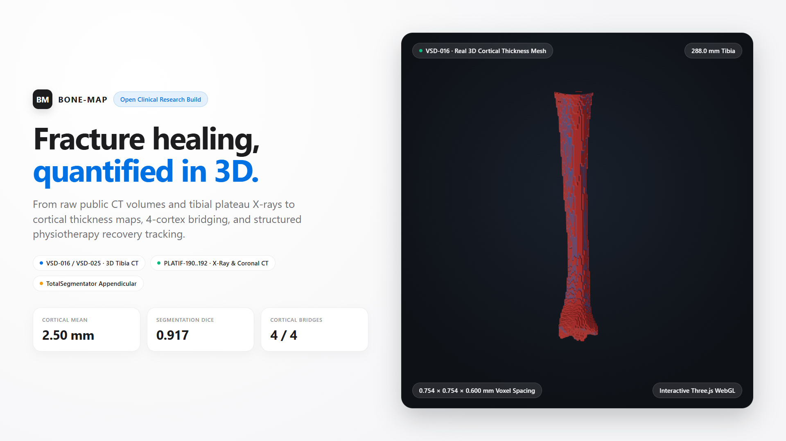
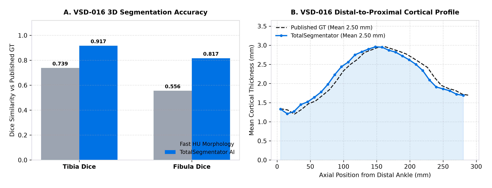
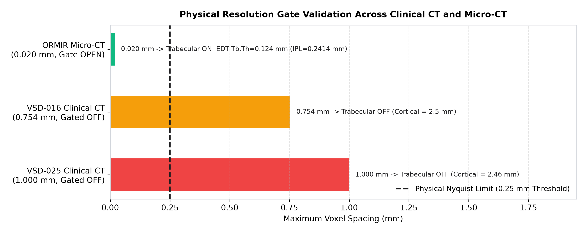

# BONE-MAP — Resolution-Gated 3D Cortical Architecture & Multi-Modal Fracture Recovery Workbench

[](https://doi.org/10.5281/zenodo.24455205)
[](https://doi.org/10.5281/zenodo.24389254)
[](LICENSE)
[](backend/pyproject.toml)
[](frontend/package.json)

**BONE-MAP** is a local-first, open-source clinical imaging and rehabilitation research workbench built to bridge the communication gap between quantitative bone radiology (`3D CT` + `2D X-ray`) and structured physiotherapy recovery tracking (`%BW`, active `ROM`, `Pain VAS`, `LEFS`, clinician-entered `mRUST`), while strictly enforcing physical resolution and calibration guardrails.



> **Preprint Paper DOI:** [`10.5281/zenodo.24455205`](https://doi.org/10.5281/zenodo.24455205) ([PDF](paper/bonemap_preprint.pdf)) &nbsp;|&nbsp; **Software DOI:** [`10.5281/zenodo.24389254`](https://doi.org/10.5281/zenodo.24389254) &nbsp;|&nbsp; **Demo Video:** [brag-output/brag.mp4](brag-output/brag.mp4)

---

## Why BONE-MAP? (Problem & Guardrail Architecture)

1. **Structural–Rehab Silo:** Orthopedists and radiologists interpret healing qualitatively on CT slices and planar radiographs, while physiotherapists titrate mechanical load progression (`% BW`, active knee `ROM`, `LEFS`, `VAS`) without standardized 3D cortical thickness or 4-quadrant bridging telemetry.
2. **Physical Honesty Over Hallucinated Metrics:** Many automated bone-analysis scripts run micro-CT trabecular algorithms on routine `0.75–1.0 mm` clinical CTs (violating the Nyquist limit) or present uncalibrated Hounsfield units (`HU`) as volumetric BMD (`mg/cm³`). **BONE-MAP refuses to fabricate physically invalid outputs:**
   - **Trabecular Nyquist Gate (`<= 0.25 mm`):** Computes medullary `Tb.Th` and `Tb.Sp` **only** when `max(voxel_spacing) <= 0.25 mm`; locks to `unavailable_clinical_ct_resolution` on coarse clinical CT.
   - **Densitometry Lock (`bmd_calibrated = False`):** Never converts uncalibrated HU into `mg/cm³` BMD without an in-scan calibration phantom.
   - **Hardware Artifact Ring (`>= 2500 HU`):** Excludes dilated metallic fixation halos before computing cortical attenuation.
   - **Fibula-Referenced Polarity:** Orients `Medial` vs `Lateral` tibial cortices dynamically using co-registered fibular anatomy across both left and right limbs.
   - **Non-Fabricated Clinical Union:** Pairs multi-modal views with an explicit clinician-entered 4-cortex `mRUST` (`4–16`) protocol instead of guessing scores from 2D pixels.

---

## Quantitative Validation Across Public Zenodo Datasets

Reproduce every table and 300 DPI figure below from a single command (`python scripts/run_paper_benchmark.py` -> [paper/benchmark_results.json](paper/benchmark_results.json)):

| Public Dataset (Zenodo) | Modality & Resolution | Key Measured Output |
| :--- | :--- | :--- |
| **`VSD-016`** (`8270365` / `8302449`) | `0.754 × 0.754 × 0.600 mm` 3D Tibia CT | **`TotalSegmentator`:** Tibia Dice **`0.9173`**, Fibula Dice **`0.8169`** (`31.75 s`), Cortical Mean **`2.50 mm`** (**`0.00 mm`** error vs `2.50 mm` Slicer GT); Fast HU fallback: `0.7385` Dice (`1.97 s`) |
| **`VSD-025`** (`8270365`) | `0.977 × 0.977 × 1.000 mm` Bilateral CT | Cortical Mean **`2.46 mm`**, `4/4` bridged quadrants (`31.82 s`), trabecular metrics properly **gated OFF** |
| **`ORMIR CHAR_NOCMP_020`** (`21284559`) | `0.020 mm` (`20 µm`) Micro-CT (VAX F-float AIM) | Nyquist gate **unlocked (`measured_high_resolution`)**: raw EDT `Tb.Th = 0.124 mm`, `Tb.Sp = 0.148 mm` (vs Scanco IPL sphere-fit reference `0.2414 ± 0.0533 mm`) |
| **`PlaTiF Part 3`** (`18007397`) | `N = 25` AP Radiographs + Tibia Masks (+ `12` Coronal CT) | Mean age **`44.1 ± 19.0` yrs** (`16–88`), `16` normal controls + `9` Schatzker Types I–VI fractures, expert tibia mask **`8.32 ± 2.78%`** of FOV |
| **`PENGWIN26`** (`19734383`) | Clinical Pelvic Trauma Control | Automatically flagged/excluded from tibial DB seeding (`~1257 cm³` bilateral pelvis anatomy) |

<p align="center">
  
  
</p>

---

## System Architecture

```text
├── backend/                     # FastAPI + SQLAlchemy (SQLite) + SimpleITK + SciPy + TotalSegmentator
│   ├── app/imaging/             # LPS canonical loader, TotalSegmentator + HU + Slicer backends, GLB mesh export
│   ├── app/quantification/      # EDT cortical thickness, fibula polarity, SVD alignment, 0.25 mm gate
│   ├── app/real_datasets.py     # Zero-synthetic Zenodo importer (VSDFullBody + PlaTiF)
│   └── tests/                   # 5/5 core contract, security, resolution-gate & polarity tests
├── frontend/                    # Next.js 16 + TypeScript + Tailwind + Three.js WebGL interactive 3D viewer
├── scripts/                     # Public Zenodo downloaders & reproducible 29-scan paper benchmark
├── paper/                       # Manuscript HTML/PDF, 300 DPI figures, cohort CSV, medRxiv checklist
└── brag-output/                 # 20s 1080p showcase MP4, poster thumbnail & storyboard
```

---

## Quick Start (Windows / Local)

### 1. Launch Full Workbench
```powershell
.\start-bonemap.ps1
```
Or start services individually:
```powershell
# Terminal 1 — Backend API (FastAPI + Python 3.12)
cd backend
.\.venv\Scripts\uvicorn.exe app.main:app --host 127.0.0.1 --port 8000 --reload

# Terminal 2 — Frontend UI (Next.js 16 + Three.js)
cd frontend
npm run dev
```
Open **http://localhost:3000**.

### 2. Optional TotalSegmentator GPU Setup
```powershell
totalseg_set_license -l <YOUR_ACADEMIC_LICENSE_KEY>
```
*(CPU fallback `auto_lower_limb` and 3D Slicer `.nii.gz` round-trip work without a license.)*

### 3. Reproduce Verification & Paper Benchmarks
```powershell
# Run core backend unit tests (5/5 passing)
cd backend
.\.venv\Scripts\python.exe -m pytest tests\test_bonemap_core.py -v

# Download public datasets into data/samples/ and regenerate all paper metrics + figures
.\.venv\Scripts\python.exe ..\scripts\fetch_public_tibia.py --dataset platif
.\.venv\Scripts\python.exe ..\scripts\download_validation_suite.py
.\.venv\Scripts\python.exe ..\scripts\run_paper_benchmark.py
```

---

## Limitations & Research Status
- **Cross-Sectional Public Validation Only:** The public cohorts evaluated here (`VSDFullBody`, `PlaTiF`, `ORMIR`) provide single-timepoint anatomy and admission imaging (`N = 0` longitudinal follow-up `CT + physiotherapy` pairs). Longitudinal predictive modeling requires prospective/retrospective IRB-approved hospital data.
- **Not a Certified Medical Device:** Intended strictly for open research, education, and benchmarking.

---

## Authors & Citation

- **Denis Paul** — Independent Researcher, Bengaluru, Karnataka, India ([ORCID: 0009-0008-1525-6822](https://orcid.org/0009-0008-1525-6822))
- **Esha Madapushi Deepak** — College of Physiotherapy (BPT), Dayananda Sagar University, Bengaluru, Karnataka, India

See [CITATION.cff](CITATION.cff) or cite:
```bibtex
@misc{paul_bonemap_preprint_2026,
  author       = {Paul, Denis and Madapushi Deepak, Esha},
  title        = {BONE-MAP: A Resolution-Gated Open-Source Architecture for 3D Cortical Fracture Quantification and Multi-Modal Rehabilitation Tracking},
  year         = {2026},
  publisher    = {Zenodo},
  doi          = {10.5281/zenodo.24455205},
  url          = {https://doi.org/10.5281/zenodo.24455205}
}

@software{paul_bonemap_2026,
  author       = {Paul, Denis and Madapushi Deepak, Esha},
  title        = {BONE-MAP: Resolution-Gated 3D Cortical Architecture Quantification and Multi-Modal Fracture Recovery Workbench},
  year         = {2026},
  version      = {1.0.0},
  publisher    = {Zenodo},
  doi          = {10.5281/zenodo.24389254},
  url          = {https://doi.org/10.5281/zenodo.24389254}
}
```

Licensed under the [MIT License](LICENSE).
